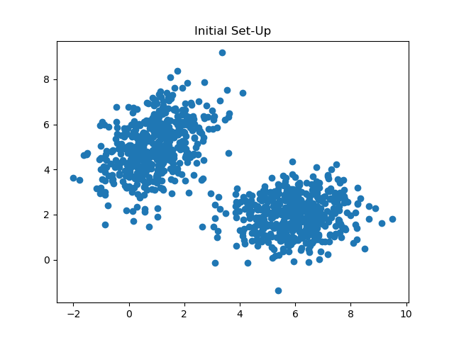
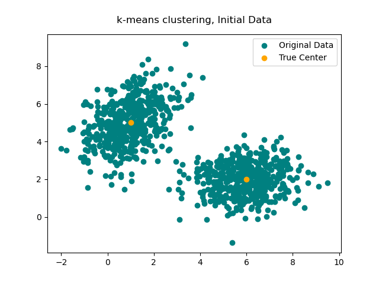
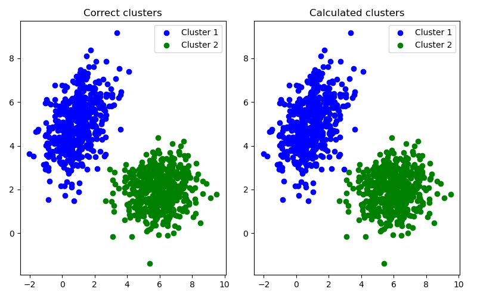
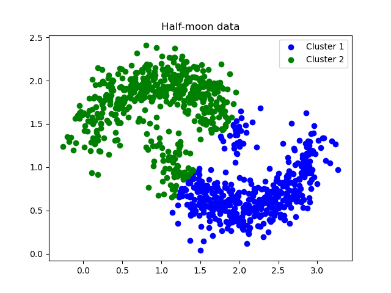

# k-means clustering
k-means clustering is a simple unsupervised machine learning algorithm that assigns each data point to a group ("cluster") based on their proximity to each other. For example, take a look at the below data:


Visually, it seems this data should split relatively cleanly into two different clusters, but how do we actually accomplish this with an algorithm? Enter k-means clustering:
<ol>
  <li>Choose k-many centers for each cluster and assign each a number 0,1,...,k-1. These initial choices can be anywhere, but, in practice, it makes sense to choose random data points to start with.</li>
  <li>Repeat the below until convergence (i.e., the centers stop moving by a significant distance):</li>
  <ol>
    <li>Assign each data point to a cluster based on which center they are closest to (measured as Euclidean distance).</li>
    <li>Calculate the average position of each cluster and use those as the new centers for the next iteration.</li>
  </ol>
</ol>

When you execute this algorithm, here's how it looks:


Even with an unlucky choice of initial centers, we get close to the correct choice of centers after a few iterations. Since this data is simulated, we can even see what the correct answer should have been:


Only one point was misclassified, and it was a borderline case. In applications, we won't know what the correct clusters should have been and, depending on the circumstances, may wish to include that one point in other cluster even if we did know. k-means clustering minimizes the sum of squared Euclidean distances of each data point to its cluster center. Mathematically, let the data points in each cluster $`\ell\in\{0,1,...,k-1\}`$ belong to the set $`X_\ell`$ with center $\boldsymbol{m}_\ell$. Then, k-means clustering minimizes the sum of squared distances, $`SSD`$:

```math
SSD = \sum_{\ell=0}^{k-1} \sum_{\boldsymbol{x}_i \in X_\ell} ||\boldsymbol{x}_i - \boldsymbol{m}_\ell||_2^2
```
<br>
A few issues to be aware of:
<ol>
  <li>This is a local minimum, meaning that you may get different results depending on your initial choices of centers.</li>
  <li>k-means clustering also requires many computations which other algorithms seek to reduce.</li>
  <li>No guidance is given on the number of clusters to choose, so the only option is to run the algorithm for many different values of k and examine each resulting $SSD$.</li>
  <li>It can only detect clusters that are shaped like blobs.</li>
</ol>

On that last point, there are shapes for clusters that might be plain to the human eye but difficult to describe mathematically. Take for example, k-means clustering applied to a "half-moon" dataset:


Here, k-means clustering fails at capturing the interesting shape this dataset has. While the solution for this type of data is beyond the scope of this write-up, graph theory and linear algebra can come to the rescue, as they often can, with spectral clustering.
